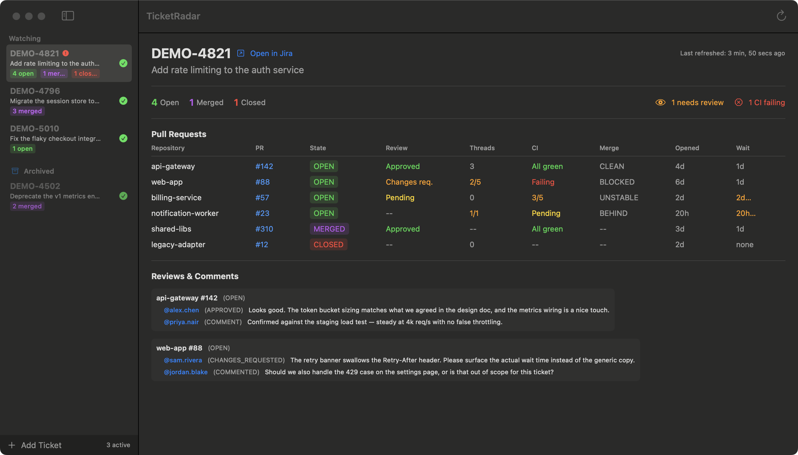
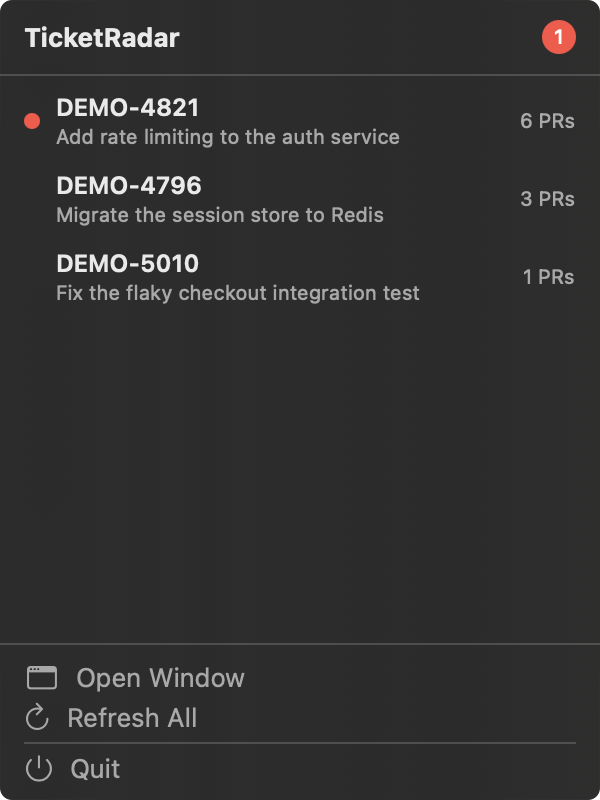
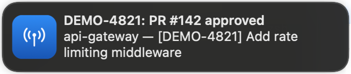
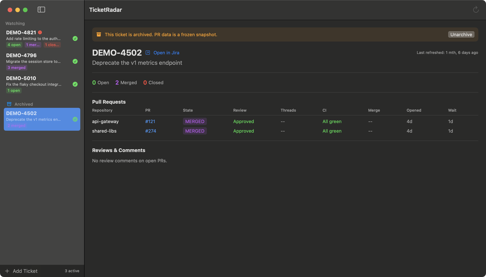

# TicketRadar

**A macOS menu bar app that monitors your Jira tickets' pull request status at a glance.**

Track multiple Jira tickets, see their linked GitHub PRs, review status, CI health, and get notified when things change — all without leaving your desktop.

   [](https://github.com/asolfre/ticket-radar/actions/workflows/ci.yml)

---

## What It Does

You paste a Jira ticket key. TicketRadar finds every linked GitHub PR — both the
smart-links in the ticket description and any PR whose title mentions the key —
and shows you:

| Column | What you see |
|--------|-------------|
| Repository | Which repo the PR is in |
| PR | Clickable link to the PR |
| State | OPEN / MERGED / CLOSED |
| Review | Approved, Changes Requested, Pending |
| Threads | Unresolved review threads |
| CI | All green / Failing / Pending |
| Merge | CLEAN / BLOCKED |
| Age | How long the PR has been open (or how long it took to merge) |
| Review wait | Time to first review — flags PRs nobody has looked at yet |

Plus raw review comments grouped by author — no AI interpretation, just the facts.

---

## The Problem It Solves

A single Jira ticket often spans **5-15 pull requests** across multiple
repositories. Tracking their collective status means:

- Opening each PR individually on GitHub
- Mentally aggregating review states, CI results, and merge readiness
- Repeating this multiple times a day across several tickets

TicketRadar collapses all of that into one view. Add a ticket key, see every
linked PR's status instantly. Know at a glance which PRs are blocking your
merge, which need your attention, and which are done — across all repos, all
at once.

**Example:** A ticket like PROJ-7328 might touch `core-libs`, `api-gateway`,
`event-processor`, `test-automation`, and `infra-charts`. Instead of 5
browser tabs and 15 clicks, you see one table with the full picture.

---

## Screenshots

Captured from anonymized demo data (`TR_DEMO=1`), not real Jira/GitHub content —
see [`docs/plans/demo-data.md`](docs/plans/demo-data.md).

| View | Screenshot |
|------|-----------|
| Main window |  |
| Menu bar popover |  |
| Notification |  |
| Archive section |  |

---

## Why `gh` + `acli` Instead of Direct APIs?

TicketRadar shells out to the GitHub CLI (`gh`) and Atlassian CLI (`acli`) rather than calling REST APIs directly. This is a deliberate design choice:

| Benefit | Explanation |
|---------|-------------|
| **Zero token management** | No API keys to configure, rotate, or store. Both CLIs handle OAuth/session tokens. You log in once in your terminal, TicketRadar reuses that. |
| **No secrets in the app** | Nothing sensitive is persisted. Auth lives in `gh`'s and `acli`'s own credential stores. |
| **Always up-to-date** | When GitHub or Jira change their APIs, the CLI maintainers update the tools. TicketRadar doesn't break. |
| **Enterprise-friendly** | Works with GitHub Enterprise and Atlassian Cloud out of the box — whatever `gh` and `acli` are configured to talk to. |
| **Simpler codebase** | ~1200 lines of Swift. No HTTP client code, no JSON schema definitions, no pagination logic. |

---

## Features

- **Watchlist** — Add tickets by key (`PROJ-7328`) or full Jira URL
- **Hybrid PR discovery** — Finds PRs from Jira smart-links *and* from a GitHub title search, so PRs opened before they were linked still show up
- **Multiple Jira sites and GitHub orgs** — Map each ticket prefix to its Jira site and GitHub org; the app switches the active `acli` site as needed
- **Clear fixes for auth problems** — GitHub SSO blocks and expired Jira sign-ins show the exact command to fix them, with a Copy button
- **PR timing** — PR age and time-to-first-review per PR, so stalled reviews stand out
- **Archive** — Park finished tickets in a collapsible Archived section; archived tickets are skipped by polling
- **Auto-refresh** — Polls every N minutes (configurable 1–30 min)
- **macOS notifications** — PR approved, merged, CI failed, new comments
- **Menu bar + Dock** — Always visible; one click on either opens the window, even after it was closed
- **Open in browser** — Click any PR number to open it; right-click tickets to open in Jira
- **Offline-safe** — Gracefully handles network errors, retries on next poll cycle

---

## Prerequisites

| Tool | Install | Purpose |
|------|---------|---------|
| [gh](https://cli.github.com/) | `brew install gh && gh auth login` | GitHub PR status + reviews |
| [acli](https://developer.atlassian.com/cloud/acli/) (Atlassian CLI) | `brew tap atlassian/homebrew-acli && brew install acli && acli jira auth login --web` | Jira ticket data |

Both must be authenticated before launching TicketRadar.

---

## Download

Get `TicketRadar-<version>-macos-universal.zip` from the
[latest release](https://github.com/asolfre/ticket-radar/releases/latest),
unzip it and move **TicketRadar.app** to **Applications**. It runs on Apple
silicon and Intel Macs with macOS 14 or later (tested on macOS 27).

TicketRadar is not notarized by Apple, so macOS blocks the first launch. Open it
once, then go to **System Settings → Privacy & Security** and click
**Open Anyway**. Or, in Terminal:

```bash
xattr -dr com.apple.quarantine /Applications/TicketRadar.app
```

`gh` and `acli` (see [Prerequisites](#prerequisites)) are still required.

---

## Build from source

```bash
# Clone
git clone https://github.com/asolfre/ticket-radar.git
cd ticket-radar

# Generate Xcode project (project.yml is the source of truth)
brew install xcodegen
xcodegen generate

# Build
xcodebuild -project TicketRadar.xcodeproj -scheme TicketRadar \
           -destination 'platform=macOS' build

# Run the build you just made
open -n "$(xcodebuild -project TicketRadar.xcodeproj -scheme TicketRadar \
                      -destination 'platform=macOS' -showBuildSettings 2>/dev/null \
           | awk '/ BUILT_PRODUCTS_DIR/{print $3}')/TicketRadar.app"
```

Or open `TicketRadar.xcodeproj` in Xcode and press **Cmd+R**.

> The app is built into DerivedData, not the repo. Avoid globbing for
> `TicketRadar-*` — stale DerivedData folders from earlier checkouts match too,
> so you can end up launching an old build. Ask `xcodebuild` for
> `BUILT_PRODUCTS_DIR` as above.

> `swift build` is not supported — there is no `Package.swift`. See
> [`AGENTS.md`](AGENTS.md) if `xcodebuild` reports "requires Xcode".

---

## Usage

1. Click the antenna icon in the menu bar
2. Click **Open Window**
3. Press **Cmd+N** to add a Jira ticket (e.g. `PROJ-7328`)
4. Watch it auto-refresh, or press **Cmd+R** to refresh immediately

### Keyboard Shortcuts

| Action | Shortcut |
|--------|----------|
| Add ticket | Cmd+N |
| Refresh | Cmd+R |
| Delete ticket | Delete |
| Settings | Cmd+, |

---

## Configuration

Open **Settings** (Cmd+,) to configure:

- **Poll interval** — How often to refresh (1–30 minutes)
- **Notifications** — Toggle macOS notifications on/off
- **Jira base URL** — e.g. `https://yourcompany.atlassian.net`; enables the "Open in Jira" links (hidden when unset) and is the default Jira site for prefixes not listed under *Projects*
- **Projects** — one line per ticket prefix: `PREFIX = jira-site, github-org`, e.g.
  ```
  DATA = acme.atlassian.net, acme-data
  API = acme-labs.atlassian.net, acme-health
  ```
  Both values are optional, in either order (a value with a dot is the Jira site). With several Jira sites the app runs `acli jira auth switch --site …` before fetching a ticket from another site, so the active `acli` site in your terminal changes too.
- **GitHub organization** — e.g. `my-org`; also finds PRs whose *title* mentions the ticket key, even if they aren't linked in Jira yet. Default for prefixes without an org under *Projects*. Leave empty to infer it from PRs already linked in the ticket.
- **Custom PATH** — Override if `gh`/`acli` aren't found automatically

Data is stored in `~/Library/Application Support/TicketRadar/`.

---

## Troubleshooting

### Jira: "unauthorized" for one site

**Symptom:** tickets from one Jira site fail with *"acli failed … unauthorized"*, while other sites work.
`acli` keeps one sign-in per site, and `acli jira auth login --web` renews **only the active site's** sign-in.

**Fix:** switch to that site first, then sign in and pick the same site in the browser:

```bash
acli jira auth switch --site <site> && acli jira auth login --web
```

The ticket's error banner shows this command with a **Copy** button.

**Verify:** `acli jira auth switch --site <site> && acli jira workitem view <KEY> --fields summary`

### PR search blocked by SAML single sign-on

**Symptom:** a ticket shows no PRs, or *"Partial: PR search failed: GitHub SAML single sign-on required…"*.
Orgs protected by SSO block `gh search` until your token is authorized again. SSO sessions expire, so this comes back from time to time.

**Fix:** do both steps, in this order. The browser sign-in alone is not enough.

1. Open `https://github.com/orgs/<org>/sso` and finish your company sign-in.
2. Run `gh auth refresh -h github.com` and approve it in the same browser.

Settings and the ticket's error banner show both steps with a link and a **Copy** button.

**One-time check:** the org shows a ✓ under *Organization access* at
<https://github.com/settings/connections/applications/178c6fc778ccc68e1d6a> (the GitHub CLI app).

**Still failing:** retry on the company VPN or corporate network; the org's conditional access policy may also check your network or device.

**Verify:**

```bash
gh search prs <KEY> --owner <org> --match title --json url,title
```

---

## Architecture

```
TicketRadar (SwiftUI, macOS 14+)
├── Menu bar icon + popover
├── Full window (NavigationSplitView)
├── TicketStore (@MainActor @Observable) — watchlist, refresh, polling, archive
├── Services
│   ├── ShellExecutor    → async Process wrapper with PATH resolution
│   ├── JiraService      → acli → ticket title + PR URLs
│   ├── GitHubService    → gh → PR status + reviews + timings (parallel)
│   ├── NotificationService → UNUserNotificationCenter (change diffing)
│   └── PersistenceService  → JSON encode/decode watchlist + settings
└── Persistence (JSON in ~/Library/Application Support)
```

Build config lives in `project.yml` (XcodeGen). There is no `Package.swift`.

---

## Documentation

| Doc | Purpose |
|-----|---------|
| [`AGENTS.md`](AGENTS.md) | How to build the project (and the gotchas) |
| [`docs/implementation-plan.md`](docs/implementation-plan.md) | Architecture, data models, phase history, what shipped beyond the plan |
| [`docs/plans/`](docs/plans/README.md) | Feature plans and backlog, with status |

---

## License

MIT
